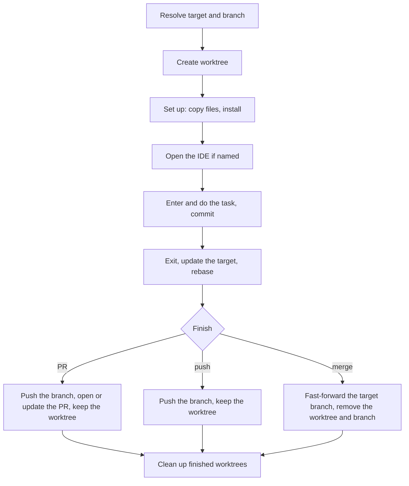

# Isolation

`/git isolation <task> [--from <branch> | --current] [ide]` (alias: `/git isolate`, also accepts `/git isolate <branch> <task>`) does the task in a separate worktree without touching the main checkout unless `--current` or a local merge into its branch is chosen.

## Names

| Item          | Value                                                                                                     |
|---------------|-----------------------------------------------------------------------------------------------------------|
| `<task>`      | a short kebab-case slug of the task                                                                       |
| worktree path | `../.tmp/<repo>/<task>` from the main checkout root; `<repo>` is the main checkout's folder name          |
| `<branch>`    | the project's branch naming applied to `<task>`, else `<task>`                                            |
| `<target>`    | `--current`: the branch current in the main checkout; `--from <base>` or a base branch named in the request (strip `origin/`): `origin/<base>` after `git fetch origin`, else local `<base>`; else from `Project overrides`, or `origin/<default>` when the main checkout is on `<default>` — on any doubt (e.g. the main checkout is on another branch and no base was named), ask the user before starting. Recorded as `<branch>`'s upstream so it survives across sessions; pushes never pass `-u` |

## Start

1. Run `git fetch origin` when `<target>` is on `origin`. Then `git worktree add --track -b <branch> <path> <target>` — `--track` makes `<target>` the branch's upstream. `<path>`, `<branch>` or `origin/<branch>` already exists: [clean up](#clean-up) the local worktree and branch first when its PR is merged (if `origin/<branch>` still exists, ask for another task name), otherwise ask for another task name.
2. Copy gitignored files from the main checkout: those matching `.worktreeinclude` patterns when the repo has one, else `.env*` files outside dependency folders.
3. Install dependencies with the project's install command; else, by the lockfile, in frozen mode: `npm ci`, `pnpm install --frozen-lockfile`, `yarn install --immutable` (Yarn 1: `--frozen-lockfile`), `bun install --frozen-lockfile`. A failed install: report and ask.
4. IDE named: open the worktree with the IDE's command-line launcher — for JetBrains IDEs, the Toolbox shell script such as `webstorm`. No launcher found: give the user the path.
5. Enter the worktree: Claude Code's `EnterWorktree` tool with `path` — the user approves once, since the path is outside the project. Without that tool, keep the main session where it is and address the worktree by absolute paths and `git -C <path>`; a `cd` outside the project does not persist between commands.

Handle the task itself in the normal flow inside the worktree; commit with the [Commit](../SKILL.md#commit) rules.

## Finish

Once the task is done, use the finish action (`PR`, `merge` or `push`) from the request or `Project overrides`; if neither sets it, ask the user (offer `PR` only when the project uses a Git host; otherwise offer `merge` or `push`). The target is `git rev-parse --abbrev-ref <branch>@{upstream}`.

1. Commit everything in the worktree.
2. Leave the worktree: `ExitWorktree` when you entered with `EnterWorktree` — while inside, Claude Code blocks git commands aimed at the main checkout.
3. Update `<target>`:
   - Remote `<target>` (`origin/<base>`): `git fetch origin <base>` — do not touch the main checkout.
   - Local `<target>` (`--current` or a local-only base) that tracks a remote branch: `git -C <worktree> pull --ff-only` in the worktree where `<target>` is checked out (`git worktree list`), else `git fetch <remote> <remote branch>:<target>`. Diverged: stop and report. A local `<target>` without a remote branch stays as it is: a merge works locally, a PR needs `<target>` pushed first — ask.
4. `git -C <path> rebase <target>`. When `origin/<branch>` already has commits that the rebase would rewrite, ask first per [Safety](../SKILL.md#safety): if declined, skip the rebase for `PR` or `push`, or stop for `merge`. A conflict: `git -C <path> rebase --abort`, report the files, stop.
5. Then:
   - **PR**: `git -C <path> push origin <branch>` (with `--force-with-lease` when the user approved rewriting pushed commits), then open or update the PR against `<target>` without `origin/` — through the `tracker` skill when installed, otherwise ask before running host commands. Keep the worktree and branch: [Clean up](#clean-up) removes them once the PR is merged.
   - **push**: push `<branch>` the same way; keep the worktree and branch.
   - **merge**: the branch to fast-forward is `<target>` without `origin/`. In the worktree where that branch is checked out (`git worktree list`), run `git -C <worktree> merge --ff-only <branch>`; if it is not checked out in any worktree, run `git fetch . <branch>:<target branch>` in the main checkout. Then `git worktree remove <path>` and delete `<branch>` (`git branch -d <branch>`, or `-D` when `<target>` was `origin/<base>` and `<target branch>` is not `HEAD`).

## Clean up

At the end of every `isolation` run, and for `isolation cleanup [task]`, check each worktree under `../.tmp/<repo>/` from `git worktree list`:

- When the `tracker` skill is installed: its branch has a PR the tracker shows merged, the PR head commit equals the local branch tip, and the worktree is clean: `git worktree remove <path>`, then `git branch -D <branch>` — a squash merge leaves the branch unmerged for git.
- Otherwise, or when `isolation cleanup` names a task without a merged PR: ask before removing; uncommitted changes need approval to discard, per Safety.
- Anything else stays; list it in the report.
